<div align="center">



<a href="https://github.com/CaptainSanskar4U/bites-and-brew-cafe">
  
</a>

<br/>


<br/>


**A luxury editorial one-page café experience.**
Dark espresso palette · champagne gold · GSAP scroll theatre · hand-built, zero frameworks.

[](#-live-now)
[](https://vercel.com/new/clone?repository-url=https%3A%2F%2Fgithub.com%2FCaptainSanskar4U%2Fbites-and-brew-cafe)

</div>

---

<div align="center">

## ☕ LIVE NOW

**→ [bites-and-brew-cafe.vercel.app](https://bites-and-brew-cafe.vercel.app) ←**

*Auto-deployed on every push. Fresh batch, always.*

</div>


## ✦ What's brewing in here

<table>
<tr>
<td width="50%" valign="top">

### 🎬 Motion & Feel
GSAP + ScrollTrigger drive the whole show — a cinematic preloader, dual counter-scrolling marquees, staggered word-split hero reveals, parallax imagery, magnetic buttons, a fluid custom cursor, and a state-aware reservation flow.

</td>
<td width="50%" valign="top">

### 🏆 The Pitch Build
This is a concept marketing site built for **Bites & Brew — The Fusion Café**, CBD Belapur. Complete with real photography, live open/closed status logic, an in-store menu board modal, and structured data for local SEO.

</td>
</tr>
<tr>
<td valign="top">

### ☕ Signature Details
- Live "OPEN NOW" pill driven by actual opening hours
- Three-chapter ambiance switcher (morning / rush / twilight)
- Interactive gallery with lightbox
- Reservation modal + footer RSVP + tasting circle signup
- Copy-address toast, scroll-progress ring, film grain overlay

</td>
<td valign="top">

### ⚙️ Under the Hood
- **Zero build step** — open `index.html`, that's it
- Semantic HTML5 + JSON-LD (`CafeOrCoffeeShop` schema)
- ~68 KB of hand-rolled CSS, ~32 KB of vanilla JS
- `clamp()` fluid type, custom design tokens, reduced-motion aware
- Accessibility-minded: ARIA roles, focus states, keyboard support

</td>
</tr>
</table>


<div align="center">

## 🧪 The Brew-o-meter

</div>

```text
ART DIRECTION   ██████████  distilled, consistent, on brand
MOTION DESIGN   █████████▒  GSAP does heavy lifting. It lands.
PHOTOGRAPHY     ████▒░░░░░  reshoot pending — the sugar sachet knows what it did
CONTRAST        █████▒░░░░  gold-on-photo captions need a rescue
VIBE            ██████████  would order a second cortado just to stay longer
```

<details>
<summary><b>🔬 Click to unbrew the stack (tech details)</b></summary>

<br/>

| Layer | Choice | Why |
|---|---|---|
| Markup | Semantic HTML5 | Structure that screen readers respect |
| Styling | Vanilla CSS + custom properties | Design tokens, `clamp()` type scale, no build step |
| Motion | GSAP 3 + ScrollTrigger (CDN) | Industry-grade easing & scroll orchestration |
| Icons | Inline SVG | Zero requests, fully stylable |
| Type | Syne · Cormorant Garamond · Plus Jakarta Sans | Avant-garde display × haute editorial serif |
| Hosting | Vercel | Static, global, deploys on every push |

</details>


## ✦ Project structure

```text
bites-and-brew-cafe/
├── index.html              # The whole experience, semantically structured
├── style.css               # 68 KB design system — tokens, layout, motion states
├── script.js               # 32 KB of interactions, GSAP choreography & logic
├── iloveimg-converted/     # Curated interior & confection photography
├── MOreCafePhtos/          # Kitchen, patisserie & storefront archive
└── assets/                 # Animated README artwork (SVG, hand-rolled ✦)
    ├── banner.svg
    ├── divider.svg
    └── footer.svg
```


## ✦ Run it locally

```bash
# Any static server works. Pick your poison:
npx serve .
# or
python -m http.server 8080
# or the simplest option: double-click index.html
```

Then open **http://localhost:8080** and try not to order a latte.


## ✦ Deploy your own

[](https://vercel.com/new/clone?repository-url=https%3A%2F%2Fgithub.com%2FCaptainSanskar4U%2Fbites-and-brew-cafe)

```bash
npm i -g vercel
vercel        # preview
vercel --prod # go live
```


## ✦ Roadmap

- [x] Craft the design system — dark roast + champagne gold
- [x] Wire GSAP scroll theatre & micro-interactions
- [x] Ship to GitHub & auto-deploy on Vercel
- [ ] Reshoot hero photography (fewer sachets, more mood)
- [ ] Tighten the dead space between sections (it's a *café*, not a cathedral)
- [ ] Lift low-contrast captions past WCAG AA
- [ ] Add real Google Reviews feed

<br/>

<div align="center">


<sub>© 2026 Bites & Brew — The Fusion Café · Concept & Design for Pitch<br/>
If this repo made you hungry, drop a ⭐ — it's the only tip jar we have.</sub>

</div>
